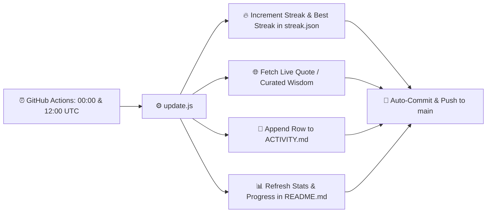

<div align="center">

# ⚡ Daily Auto-Commit & Activity Bot

[](https://github.com/riduanShihab/commit/actions/workflows/daily-commit.yml)
[](https://github.com/riduanShihab/commit)
[](LICENSE)

An automated, 24/7 cloud-scheduled bot powered by **GitHub Actions** that logs daily commits, tracks activity streaks, and chronicles developer wisdom and programming quotes.

</div>

---

## 📈 Live Streak Dashboard

<!-- DAILY-STATS:START -->
<div align="center">

[](#-live-streak-dashboard)
[](#-live-streak-dashboard)
[](#-live-streak-dashboard)
[](#-live-streak-dashboard)

| 🔥 Current Streak | 🏆 Longest Streak | 🚀 Total Commits | 🎯 Current Tier | 📅 Last Updated |
| :---: | :---: | :---: | :---: | :---: |
| **19 Days** | **19 Days** | **19 Automated** | **🚀 Momentum** | **2026-10-24 15:17:22 UTC** |

<br/>

**🎯 Next Milestone (19/30 Days)**  
`[██████░░░░░░░░░░░░] 31%`

<br/>

> 💡 **Wisdom Chronicle (Wisdom & Mindset)**  
> 💬 _"Kindness in words creates confidence. Kindness in thinking creates profoundness. Kindness in giving creates love."_  
> — **Lao Tzu**  
> <small>Source: 🌐 Live API (ZenQuotes)</small>

</div>
<!-- DAILY-STATS:END -->

👉 **[View Full Activity Journal](ACTIVITY.md)**

---

## 🚀 How It Works



1. **GitHub Actions Schedule**: Runs twice daily at `00:00 UTC` and `12:00 UTC` (or whenever triggered manually via `workflow_dispatch`).
2. **Zero Overhead**: Runs entirely on GitHub's cloud runners without requiring any local machine to stay powered on.
3. **Dynamic Wisdom & Insights**: Fetches live quotes via public APIs with automatic fallback to a local 60+ quote curated archive.
4. **Streak & Milestone Progression**: Tracks active streak, historical best streak, total commits, tier badges, and visual milestone progress bars.
5. **Meaningful Commits**: Rather than creating empty or dummy commits, each run updates a live counter, selects curated engineering wisdom, and records a timestamped entry in [`ACTIVITY.md`](ACTIVITY.md).

---

## ⚙️ One-Time Setup Requirement (Crucial)

To enable GitHub Actions to push commits back to your repository:

1. Open this repository on **GitHub**.
2. Navigate to **Settings** ➔ **Actions** ➔ **General**.
3. Scroll down to **Workflow permissions**.
4. Select **"Read and write permissions"**.
5. Click **Save**.

*(Without this setting, GitHub Actions will get a `403 Permission Denied` when attempting `git push`).*

---

## 🧪 Manual Trigger / Testing

You can test or run the workflow anytime without waiting for the scheduled time:

- **Via GitHub**:
  1. Go to the **Actions** tab on your repository.
  2. Select **Daily Auto Commit** from the left sidebar.
  3. Click **Run workflow** ➔ **Run workflow**.

- **Via Local Machine**:
  ```bash
  node update.js
  ```
  *(or run `run-local.bat` to automatically pull, execute, commit, and push in one go).*

---

## 📁 Repository Structure

```
.
├── .github/workflows/
│   └── daily-commit.yml   # Multi-schedule Cron & workflow configuration
├── ACTIVITY.md            # Daily log of timestamps, quotes, categories & sources
├── README.md              # Project dashboard, badges & documentation
├── quotes.json            # 60+ curated developer wisdom & quotes
├── streak.json            # Streak, milestone, and counter state file
├── run-local.bat          # 1-click local sync, run, and push batch script
└── update.js              # Script executed on each automated cycle
```

---

## 📄 License

This project is open-source and available under the [MIT License](LICENSE).
