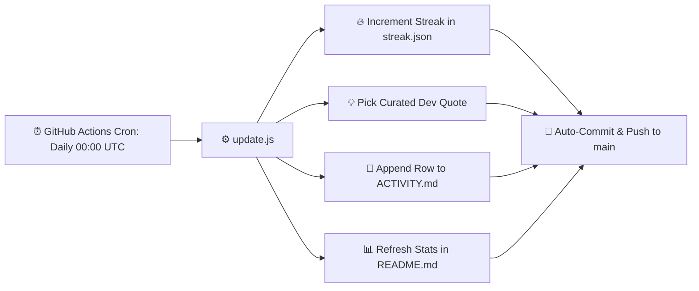

<div align="center">

# ⚡ Daily Auto-Commit & Activity Bot

[](https://github.com/riduanShihab/commit/actions/workflows/daily-commit.yml)
[](https://github.com/riduanShihab/commit)
[](LICENSE)

An automated, 24/7 cloud-scheduled bot powered by **GitHub Actions** that logs daily commits, tracks activity streaks, and chronicles developer wisdom and programming quotes.

</div>

---

## 📈 Live Streak Dashboard

<!-- DAILY-STATS:START -->
<div align="center">

| 🔥 Current Streak | 🚀 Total Commits | 📅 Last Updated |
| :---: | :---: | :---: |
| **1 Day** | **1 Commit** | **2026-10-16 21:38:15 UTC** |

> 💬 _"Truth can only be found in one place: the code."_  
> — **Robert C. Martin**

</div>
<!-- DAILY-STATS:END -->

👉 **[View Full Activity Journal](ACTIVITY.md)**

---

## 🚀 How It Works



1. **GitHub Actions Schedule**: Every day at `00:00 UTC` (or whenever triggered manually), GitHub executes the `.github/workflows/daily-commit.yml` workflow.
2. **Zero Overhead**: Runs entirely on GitHub's cloud runners without requiring any local machine to stay powered on.
3. **Meaningful Commits**: Rather than creating empty or dummy commits, each run updates a live counter, selects curated engineering wisdom, and records a timestamped entry in [`ACTIVITY.md`](ACTIVITY.md).

---

## ⚙️ One-Time Setup Requirement (Crucial)

To enable GitHub Actions to push commits back to your repository:

1. Open this repository on **GitHub**.
2. Navigate to **Settings** ➔ **Actions** ➔ **General**.
3. Scroll down to **Workflow permissions**.
4. Select **"Read and write permissions"**.
5. Click **Save**.

*(Without this setting, GitHub Actions will get a `403 Permission Denied` when attempting `git push`).*

---

## 🧪 Manual Trigger / Testing

You can test or run the workflow anytime without waiting for the scheduled time:

- **Via GitHub**:
  1. Go to the **Actions** tab on your repository.
  2. Select **Daily Auto Commit** from the left sidebar.
  3. Click **Run workflow** ➔ **Run workflow**.

- **Via Local Machine**:
  ```bash
  node update.js
  ```

---

## 📁 Repository Structure

```
.
├── .github/workflows/
│   └── daily-commit.yml   # Cron & workflow configuration
├── ACTIVITY.md            # Daily log of timestamps and quotes
├── README.md              # Project dashboard & documentation
├── quotes.json            # Curated dev quotes and wisdom
├── streak.json            # Streak counter state file
└── update.js              # Script executed on each cycle
```

---

## 📄 License

This project is open-source and available under the [MIT License](LICENSE).
